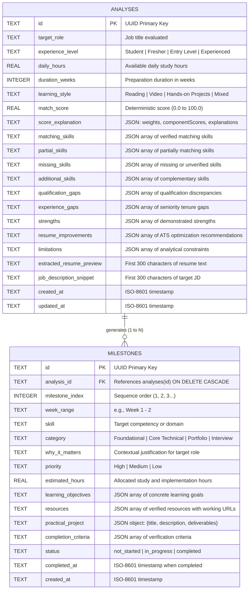

# Database Design Specification

## Project Title
**AI-Based Skill Gap Analysis and Personalized Career Roadmap Generation System**

---

## 1. Overview & Technology Selection

The system utilizes an embedded **SQLite** relational database (`career_roadmap.sqlite`), operating with zero external database server configuration.

### Rationale for SQLite:
- **Zero Configuration:** Eliminates the need for external database servers (e.g., PostgreSQL or MySQL), ensuring complete local reproducibility for capstone evaluators.
- **ACID Compliance:** Guarantees atomic transaction execution and data integrity during milestone creation and updates.
- **Native Node.js Support:** Directly accessible via Node.js built-in `node:sqlite` (`DatabaseSync`), requiring no native C++ compiler tools on the host OS.
- **Cascading Referential Integrity:** Automatically cleans up associated learning milestones when an analysis record is deleted.

---

## 2. Entity-Relationship (ER) Diagram

---

## 3. Data Dictionary

### Table 1: `analyses`
Maintains top-level evaluation sessions, computed match scores, and categorical skill arrays.

| Column Name | Data Type | Constraints | Description |
| :--- | :--- | :--- | :--- |
| `id` | `TEXT` | `PRIMARY KEY` | Standard UUID v4 string identifier. |
| `target_role` | `TEXT` | `NOT NULL` | The job title specified by the candidate. |
| `experience_level` | `TEXT` | `NOT NULL` | Declared candidate stage (`Student`, `Fresher`, `Entry Level`, `Experienced`). |
| `daily_hours` | `REAL` | `NOT NULL` | Available study hours per day (0.5 to 16.0). |
| `duration_weeks` | `INTEGER` | `NOT NULL` | Total target preparation weeks (1 to 52). |
| `learning_style` | `TEXT` | `NOT NULL` | Preferred modality (`Hands-on Projects`, `Reading`, `Video`, `Mixed`). |
| `match_score` | `REAL` | `NOT NULL` | Final deterministic compatibility score (0.0 to 100.0). |
| `score_explanation` | `TEXT` | `NOT NULL` | Serialized JSON containing component weights and justification. |
| `matching_skills` | `TEXT` | `NOT NULL` | Serialized JSON array of skills evidenced in resume. |
| `partial_skills` | `TEXT` | `NOT NULL` | Serialized JSON array of skills with partial/foundational evidence. |
| `missing_skills` | `TEXT` | `NOT NULL` | Serialized JSON array of required skills absent from resume. |
| `additional_skills`| `TEXT` | `NOT NULL` | Serialized JSON array of complementary skills present in resume. |
| `qualification_gaps`| `TEXT` | `NOT NULL` | Serialized JSON array of degree or credential discrepancies. |
| `experience_gaps` | `TEXT` | `NOT NULL` | Serialized JSON array of professional tenure gaps. |
| `strengths` | `TEXT` | `NOT NULL` | Serialized JSON array of identified candidate strengths. |
| `resume_improvements`| `TEXT` | `NOT NULL`| Serialized JSON array of tailored ATS bullet enhancements. |
| `limitations` | `TEXT` | `NOT NULL` | Serialized JSON array of assessment caveats. |
| `extracted_resume_preview` | `TEXT` | `NULL` | Truncated snippet (first 300 chars) for history preview. |
| `job_description_snippet` | `TEXT` | `NULL` | Truncated snippet (first 300 chars) for history preview. |
| `created_at` | `TEXT` | `NOT NULL` | ISO 8601 UTC creation timestamp. |
| `updated_at` | `TEXT` | `NOT NULL` | ISO 8601 UTC last update timestamp. |

---

### Table 2: `milestones`
Maintains individual time-bounded learning milestones synthesized for an analysis.

| Column Name | Data Type | Constraints | Description |
| :--- | :--- | :--- | :--- |
| `id` | `TEXT` | `PRIMARY KEY` | Standard UUID v4 string identifier. |
| `analysis_id` | `TEXT` | `NOT NULL, FK` | Foreign key referencing `analyses(id)` with `ON DELETE CASCADE`. |
| `milestone_index` | `INTEGER` | `NOT NULL` | Order index of the milestone (1 to N). |
| `week_range` | `TEXT` | `NOT NULL` | Formatted calendar range (e.g. `Week 1 - 2`). |
| `skill` | `TEXT` | `NOT NULL` | Primary competency or tool to learn. |
| `category` | `TEXT` | `NOT NULL` | Stage (`Foundational`, `Core Technical`, `Portfolio`, `Interview`). |
| `why_it_matters` | `TEXT` | `NOT NULL` | Rationale explaining relevance to target role. |
| `priority` | `TEXT` | `NOT NULL` | Importance ranking (`High`, `Medium`, `Low`). |
| `estimated_hours` | `REAL` | `NOT NULL` | Total hours allocated for completion. |
| `learning_objectives` | `TEXT` | `NOT NULL` | Serialized JSON array of specific goals. |
| `resources` | `TEXT` | `NOT NULL` | Serialized JSON array of resource objects (`{title, type, url}`). |
| `practical_project` | `TEXT` | `NOT NULL` | Serialized JSON object detailing hands-on deliverable. |
| `completion_criteria` | `TEXT` | `NOT NULL` | Serialized JSON array of verification criteria. |
| `status` | `TEXT` | `DEFAULT 'not_started'` | Completion state (`not_started`, `in_progress`, `completed`). |
| `completed_at` | `TEXT` | `NULL` | ISO timestamp recorded when marked completed. |
| `created_at` | `TEXT` | `NOT NULL` | ISO 8601 UTC creation timestamp. |

---

## 4. Indexing & Optimization Strategy

1. **`idx_milestones_analysis_id` on `milestones(analysis_id)`**:
   Enables sub-millisecond retrieval of all milestones when loading an analysis dashboard or PDF report.
2. **`idx_analyses_created_at` on `analyses(created_at DESC)`**:
   Ensures instantaneous query execution for the historical assessment timeline view.
3. **Write-Ahead Logging (WAL):**
   SQLite is configured with `PRAGMA journal_mode = WAL;` and `PRAGMA foreign_keys = ON;` on initialization, enabling concurrent read transactions while writes are executing.
