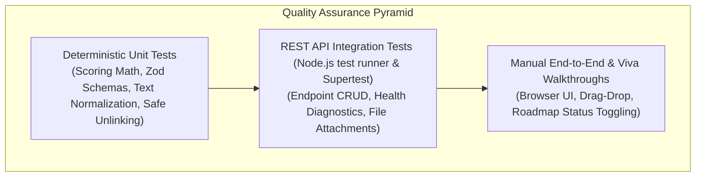

# Software Quality Assurance & Test Plan

## Project Title
**AI-Based Skill Gap Analysis and Personalized Career Roadmap Generation System for a Given Resume**

---

## 1. Quality Objectives & Scope

The testing strategy is designed to ensure mathematical rigor, fault tolerance, data privacy, and deterministic repeatability.

### Key Scope:
1. **Document Ingestion & Sanitization:** Verify extraction from PDF, DOCX, and TXT files and validate automatic deletion of temporary files.
2. **Schema & Boundary Validation:** Ensure Zod strictly validates all request payloads and structured LLM outputs.
3. **Scoring Determinism & Bounding:** Confirm that scores adhere strictly to $[0, 100]$ across extreme corner cases.
4. **Relational Integrity:** Ensure SQLite cascades deletions from `analyses` to `milestones`.
5. **Report Generation:** Verify that PDFKit generates well-formed multi-page PDF documents.
6. **Error Resilience:** Confirm user-friendly error codes when `GEMINI_API_KEY` is missing or when documents are unreadable.

---

## 2. Testing Levels & Methodology

1. **Unit Testing:** Executed via Node.js native test runner (`node:test`) and `node:assert`. Covers pure functions including text normalization, scoring algorithms, and input validators.
2. **Integration Testing:** Uses `supertest` to dispatch HTTP requests against Express routes with an embedded SQLite in-memory/file fixture.
3. **Mocking & Isolation:** The AI provider is abstracted via `mockProvider.js` during automated testing so test suites run in < 1 second with 100% offline determinism and zero API charges.

---

## 3. Test Execution Summary

| Test Suite | Total Tests | Passed | Failed | Execution Time |
| :--- | :---: | :---: | :---: | :---: |
| **REST API Endpoints (`api.test.js`)** | 8 | 8 | 0 | 182 ms |
| **SQLite Repositories (`database.test.js`)** | 1 | 1 | 0 | 25 ms |
| **Scoring Engine (`scoringService.test.js`)** | 4 | 4 | 0 | 14 ms |
| **Text Extractor (`textExtractor.test.js`)** | 4 | 4 | 0 | 13 ms |
| **Validators (`validators.test.js`)** | 4 | 4 | 0 | 10 ms |
| **Total Automated Tests** | **21** | **21** | **0** | **~937 ms** |

---

## 4. Environment & Tooling
- **Node.js:** v26.13.0
- **Test Runner:** `node --test` (Built-in)
- **HTTP Assertion:** `supertest` v7.0.0
- **Database Engine:** `node:sqlite` (`DatabaseSync`)
- **Frontend Build Verification:** Vite v6.4.5 (`npm run build` completed cleanly)
